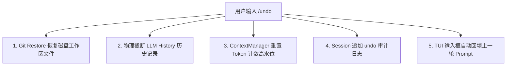

# Wasteland Git Checkpoint 与 /undo 架构设计与实现路线图

> **状态**：待实现（RFC / 架构设计已冻结，规划在后续迭代中实施）  
> **更新时间**：2026-10-18  
> **版本**：v1.0.0

---

## 一、 背景与核心价值

在 AI 自动编码（Agentic Coding）场景中，Agent 经常会在一个回合内连续调用写文件、改代码或执行 Bash 命令。开发者面临的核心痛点是：
1. **害怕改坏（安全感缺失）**：AI 编写的代码可能出现编译失败、逻辑倒退甚至误删文件，开发者难以快速恢复到改动前的干净状态；
2. **审查成本高（黑盒恐惧）**：多文件改动后，缺少直观的红绿 Diff 工具，必须切回 IDE 或手工比对；
3. **撤销体验粗糙**：传统撤销往往只恢复了文件，但 LLM 的上下文历史里仍然残留着上一轮的错误思考和报错信息，导致模型反复犯同样的错误。

本系统旨在为 Wasteland 打造**企业级代码修改快照（Git Checkpoint）与原子回滚（/undo）体系**，提供**全工作区原子性、零历史污染、外部并发编辑保护与代码/对话双轨同步**的极致体验。

---

## 二、 业内主流方案横向解构与选型对比

| 工具代表 | 底层实现机制 | 优点 | 致命缺陷与痛点 | Wasteland 采纳态度 |
| :--- | :--- | :--- | :--- | :---: |
| **Aider** | **直接 Commit 流**：在当前 Git 分支上每轮交互自动执行 `git commit`；`/undo` 走 `git reset --hard` | 实现极其简单，原生 `git log` 完全可见 | 1. 严重污染用户的 Git 历史，产生海量中间垃圾提交；<br>2. 频繁触发项目内的 Husky/Git Hooks；<br>3. 用户原有未提交代码极易被误清空。 | ❌ **反模式，严禁采纳** |
| **Cline / Roo Code** | **全局 Shadow Git 独立仓库**：在 VS Code 全局存储区建 `.git`，通过 `git --git-dir=... --work-tree=...` 提交 | 物理隔离，不污染项目自身的 Git 历史 | **致命设计缺陷（`.git_disabled` Hack）**：为了让 Git 索引嵌套仓库，它会在快照前**强行把项目中的 `.git` 重命名为 `.git_disabled`**。若进程崩溃或超时，用户的真实 Git 仓库会“凭空消失”，引发严重生产事故。 | ❌ **危险 Hack，严禁采纳** |
| **Claude Code** | **Tool 拦截式文件内容快照（CAS）**：在执行 `Write` / `Edit` 工具**前**，将受影响文件内容备份至 `~/.claude/file-history/` | 零依赖 Git，纯文件夹也能运行；支持仅回滚代码或仅回滚对话；Prompt 自动回填体验极佳 | **Shell 盲区（Shell Blindness）**：通过 `Bash` 工具执行的任何脚本修改、`rm -rf`、`npm test` 临时文件，**完全无法被前置拦截感知**，导致回滚时漏掉所有终端产生的修改！ | ⚠️ **吸纳交互哲学，底层弃用** |
| **OpenCode** | **全盘 Git 状态机**：以 Turn 为单位记录 Workspace 变更，支持 `/undo`（`ctrl+x u`）与 `/redo` | 全盘工作区覆盖，Bash 产生的所有改动也能一并捕获；TUI 内部原生渲染红绿 Diff | 传统实现多依赖临时分支切换，多分支管理稍复杂。 | ⭐️ **吸纳状态机模型** |
| **Wasteland 方案（融合增强）** | **Git Plumbing 底层专属引用 (`refs/wasteland/checkpoints/`) + 临时独立索引** | 1. **零污染**：对象保存在专有命名空间，`git log` 完全不可见；<br>2. **零干扰**：使用独立临时索引文件，完全不碰用户的暂存区；<br>3. **全覆盖**：无论是文件工具还是 Bash，整个工作区的原子变动全部被捕获；<br>4. **毫秒级性能**：利用 Git 的 C 级哈希树（`write-tree`），只存增量 Blob，开销极小。 | 需要精确封装底层 Git Plumbing 管道。 | 🏆 **确立为最终设计方案** |

---

## 三、 Wasteland 底层架构设计（Git Plumbing 管道驱动）

对于已是 Git 仓库的项目（95% 场景），底层通过无副作用的 Git Plumbing 命令闭环：

```
[当前用户工作区] (包含 AI 产生的新修改 + 用户原有的未提交代码)
       │
       ▼  1. GIT_INDEX_FILE=/tmp/wasteland-idx.<pid> git add -A
[临时隔离索引区] (独立临时文件，用户的 .git/index 绝对不受任何触碰)
       │
       ▼  2. git write-tree
 [Tree 对象] (SHA: 4b825dc6... 毫秒级生成多文件内容寻址树)
       │
       ▼  3. git commit-tree -p HEAD -m "AI Checkpoint: session_<id>_turn_<n>"
[游离 Commit 对象] (SHA: a1b2c3d4... 孤立节点，不属于任何工作区分支)
       │
       ▼  4. git update-ref refs/wasteland/checkpoints/<sessionId>/<turnId> <SHA>
[专属命名空间] (在 git log / git branch 中完全隐形，不触发任何 Git Hook)
```

### 1. 秒级撤销执行流程
当用户输入 `/undo` 时：
```bash
# 仅恢复工作区文件到快照时的状态，不移动 HEAD，不改变用户原本分支
git restore --source="refs/wasteland/checkpoints/${SESSION_ID}/${TARGET_TURN}" --staged --worktree -- .
```

### 2. 非 Git 环境兼容兜底（纯文件夹）
若用户工作目录不是 Git 仓库，底层自动在 `.wasteland/checkpoints.git` 初始化一个裸仓库（Bare Repo），通过 `--work-tree` 指向项目工作目录完成同样操作，对用户完全透明，绝不在项目根目录留存可见的 `.git`。

---

## 四、 引擎生命周期集成与状态同步

### 4.1 快照切入点：Turn 边界（Pre-Turn Boundary）
- **切入位置**：`src/core/engine/agent-loop.ts` 中 `turns$.pipe(concatMap((turn) => { ... }))` 的**最前部**；
- **核心理由**：
  - 避免“在单文件工具执行中快照”带来的海量 I/O 开销与中间断点的不一致性；
  - 形成以 **Turn 为原子单位** 的事务性基准点。一旦 AI 回答有误或破坏了代码，一键回退到发送本轮 Prompt 之前的干净静止态。

### 4.2 会话状态与 Token 上下文的“双轨同步”
当用户执行 `/undo` 时，绝不仅是回退磁盘文件，必须同步做状态治理：



1. **LLM History 物理截断（Context Truncation）**：
   - 内存中的 `history: HistoryRecord[]` 必须物理修剪掉被撤销轮次的全部记录（包括 `user`、`tool_call`、`tool_result`、`assistant`）；
   - **痛点根除**：彻底杜绝 LLM 受到上一轮错误代码和报错偏见的历史污染，保证下一轮交互处于干净上下文。
2. **Token 上下文管理器联动（ContextManager）**：
   - `ContextManager` 暴露 `rollbackToHistory()`，将 `totalTokens` 与高水位重置回目标轮次，**防止系统产生错误的早熟压缩（False Compaction）**。
3. **Session Transcript 持久化（Audit Log）**：
   - 遵循 Append-only 原则，在 `.jsonl` 追加一条特殊审计记录：`{"type": "undo", "undoneTurn": 3, "targetTurn": 2}`，确保历史可追溯、可重放。
4. **TUI 交互杀手级体验（Prompt Prefill）**：
   - 回滚成功后，自动将上一轮被撤销的 User Prompt **回填到底部输入框（ChatInputBar）**，用户无需重新打字，只需微调一两个词即可再次发送！

---

## 五、 安全边界与防护防线（Safety Invariants）

1. **3-Way Hash 外部并发冲突检测**：
   - 在撤销前，对比：$H_{\text{base}}$（本轮开始前）、$H_{\text{agent}}$（AI 修改后）、$H_{\text{disk}}$（当前磁盘）；
   - 若 $H_{\text{disk}} \neq H_{\text{agent}}$ 且 $H_{\text{disk}} \neq H_{\text{base}}$，说明**用户自己在外部编辑器手写修改了代码**！系统立即弹窗阻断，防止冲掉用户劳动成果。
2. **四层安全过滤网**：
   - **Layer 1**：严格遵循 `.gitignore`；
   - **Layer 2（凭证拦截）**：硬编码阻断 `.env*`、`*.key`、`*.pem`，绝不写入快照；
   - **Layer 3（重型依赖）**：硬编码排除 `node_modules/`、`target/`、`.venv/`、`dist/`；
   - **Layer 4（大文件与二进制）**：单文件 > 5MB 仅存元数据 Hash，避免磁盘膨胀。
3. **零丢失重做（`/redo`）与安全救援（Rescue Checkpoint）**：
   - 撤销动作前自动留存 `rescue-<timestamp>` 节点，即使手抖点错也能通过 `/redo` 或 `/undo rescue` 毫秒级恢复现场。

---

## 六、 交互设计与命令契约

### 6.1 命令契约矩阵

| 命令语法 | 适用模式 | 默认行为与语义 | 典型输出与反馈 |
| :--- | :--- | :--- | :--- |
| `/undo` | 交互式 TUI | 回退最近一轮（Turn N → Turn N-1）AI 产生的变更；若连续输入，依次向前回退 | `✓ Reverted Turn #4 (-3 files, +12/-48). Type /redo to restore.` |
| `/undo <turn-id>` | TUI / Headless | 定点穿梭回退到指定轮次开始前的基线状态（例如 `/undo 3`） | 展示跨轮次回退的文件影响矩阵并请求确认（或 `--yes` 直接执行） |
| `/undo -f <file>` | TUI / Headless | **单文件精准回退**：仅恢复指定文件至上一轮状态，保留其余文件的修改 | `✓ Restored src/auth.ts to Turn #2 baseline.` |
| `/redo` | 交互式 TUI | 撤销上一次的 `/undo`，沿快照分支前向恢复最新修改 | `✓ Re-applied Turn #4 changes (+3 files).` |
| `/checkpoints` | TUI / Headless | 打印会话内历史快照时间轴（快照 ID、时间、关联 Prompt、文件数、Diff 统计） | 结构化快照列表，高亮标注当前工作区处于的锚点 `[ACTIVE]` |
| `/diff` | 交互式 TUI | 调用内置轻量 Unified Diff 视图，显示当前工作区相对于基线的变动差异 | 红绿双色语法高亮 Diff 弹窗或流式视图 |

### 6.2 TUI 快捷键映射
- **`Ctrl+Z`**（在输入框为空时）：快捷触发 `/undo`；
- **`Ctrl+Shift+Z` / `Ctrl+Y`**（在输入框为空时）：快捷触发 `/redo`。

---

## 七、 后续实现路线图（Implementation Roadmap）

本项目不急于立即编码，后续实施将分为三个原子阶段推进：


### Phase 1：底层 Git 快照与恢复驱动（Core Engine Infrastructure）
- [ ] 创建 `src/core/checkpoint/checkpoint-types.ts`（定义快照元数据、回滚结果类型）；
- [ ] 创建 `src/core/checkpoint/git-plumbing-driver.ts`：
  - 实现基于临时索引（`GIT_INDEX_FILE`）的 `createSnapshotTree`；
  - 实现 `commitTree` 与 `updateRef(refs/wasteland/checkpoints/...)`；
  - 实现 `restoreSnapshot(refName, files?)`；
  - 实现非 Git 目录下的裸仓库（`.wasteland/checkpoints.git`）自动初始化与降级支持；
- [ ] 创建 `src/core/checkpoint/safety-guard.ts`：
  - 实现 3-Way Hash 碰撞检测；
  - 实现凭证、大文件与 `node_modules` 排除过滤；
- [ ] 编写全量单元测试（`__tests__/git-plumbing-driver.test.ts`），断言临时索引隔离性与快照完整性。

### Phase 2：引擎生命周期挂接与上下文联动（Engine Lifecycle Integration）
- [ ] 在 `src/core/engine/agent-loop.ts` 中：
  - 在 `turns$.pipe(concatMap(...))` 入口挂载 Pre-Turn Checkpoint 钩子；
  - 暴露 `rollbackTurn(targetTurnId)` 方法；
- [ ] 在 `src/core/memory/context-manager.ts` 中：
  - 增加 `rollbackToHistory(newHistory: readonly HistoryRecord[])` 方法，重置 Token 统计与压缩高水位；
- [ ] 在 `src/core/session/session-records.ts` 中增加 `UndoRecord` 审计记录持久化；
- [ ] 编写回滚场景回归单测（涵盖 `edit-file` 与 `bash` 修改的联合回滚）。

### Phase 3：命令分发与 TUI/CLI 交互落地（Command & UX Delivery）
- [ ] 在 `src/tui/hooks/useCommandDispatcher.ts` 注册 `/undo`, `/redo`, `/diff`, `/checkpoints` 指令；
- [ ] 在 `useGlobalKeymapDispatcher.ts` 中挂接 `Ctrl+Z` / `Ctrl+Shift+Z` 空输入框快捷触发；
- [ ] 在 `ChatInputBar.tsx` 中实现回滚后的上一轮 Prompt 自动回填；
- [ ] 结合 `UnifiedDiffView.tsx` 实现 `/diff` 呼出即时审查；
- [ ] 执行双层验证与全量测试套件保障。
